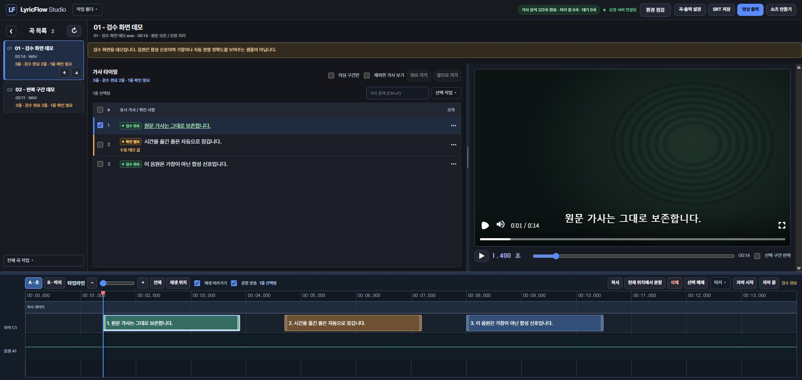
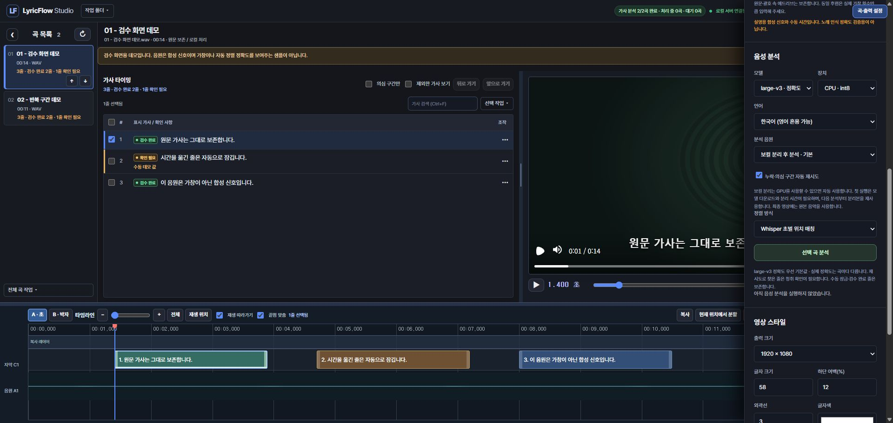

# LyricFlow Studio

음원과 원문 가사로 **자막 영상을 만드는 로컬 제작 도구**입니다. 자동으로 가사 시간 후보를 만들고, 브라우저에서 실제 노래를 들으며 수정한 뒤 개별 영상·플레이리스트·쇼츠를 출력합니다.

한국어 검수 화면, Node.js 로컬 서버, Python 음성 분석, React/Remotion 영상 구성을 사용합니다. 자동 분석 결과는 초안이며, 실제 가창과 자막 싱크의 최종 확인은 사용자가 합니다.

## 목적과 장점

노래마다 가사 시간을 처음부터 입력하고, 수정한 자막을 여러 영상 형식에 다시 옮기는 반복 작업을 줄이기 위해 만들었습니다. Suno로 만든 곡을 포함해 **음원과 원문 가사를 가진 제작자**가 직접 싱크를 확인하며 자막 영상과 음악 플레이리스트를 만드는 데 적합합니다.

- **시간 후보에서 시작**: 자동 분석이 만든 후보를 듣고 고치므로, 처음부터 모든 시간을 수동 입력하는 작업을 줄이는 것이 목표입니다. 실제 절감량은 곡과 분석 품질에 따라 달라집니다.
- **원문을 기준으로 검수**: 음성 인식이 틀려도 원문 가사를 자동으로 바꾸지 않으며, 찾지 못한 구간은 확인 대상으로 남깁니다.
- **한 작업에서 여러 출력**: 검수한 가사와 스타일을 개별 자막 영상, 플레이리스트, 선택 구간 쇼츠 제작에 활용합니다.
- **수정 내용을 보호**: 수동 잠금, 되돌리기, 저장 충돌 검사로 검수 작업을 이어갈 수 있습니다.
- **로컬에서 제작**: 음원 분석과 영상 제작을 PC에서 수행하며, 프로그램 자체의 유료 AI API 키나 클라우드 계정이 필요하지 않습니다. 모델 다운로드와 공개 Suno 링크 가져오기 등에는 인터넷이 필요합니다.

완전 자동으로 싱크를 확정하는 도구는 아닙니다. 자동 분석으로 초안을 만들고 사람이 듣고 마무리하는 흐름을 지향합니다.

## 주요 기능

- 음악 폴더의 음원과 배경 이미지 등록, 곡별 이미지 선택
- Suno 공개 곡 URL 또는 붙여넣기로 원문 가사 연결
- faster-whisper 기반 단어 인식과 원문 순서 매칭, 선택적 보컬 분리·누락 구간 재인식
- 가사 구간 반복 듣기, 시작·종료 시간 수정, 여러 줄 이동, 줄 복사·추가·삭제, 잠금과 되돌리기
- 초 단위 및 BPM 기반 마디·박 타임라인 눈금
- 미리보기와 출력이 공유하는 자막 영상 구성
- 개별 MP4/SRT, 플레이리스트와 챕터, 선택 구간 세로 쇼츠 출력
- 지원 환경에서 GPU 인코딩 사용, 자동 모드에서 GPU 시험 실패 시 CPU 전환
- 작업 큐·진행 상황·취소 및 실패 기록

## 실제 프로그램 화면

아래는 프로그램을 직접 실행해 캡처한 **검수 데모**입니다. 개인 곡·개인 가사·개인 배경 이미지는 포함하지 않았습니다. 합성 테스트 음원, 설명용 문장, 수동 타이밍을 사용하므로 음성 인식 정확도를 보여주는 예시는 아닙니다.

**가사 검수 화면 (2026-10-19 갱신)** — 곡 목록, 크기를 조절한 자막 미리보기, 확인 상태, 시간축의 가사 블록을 한 화면에서 확인합니다. 가사를 더블클릭하면 문구를 편집할 수 있고, 타임라인 오른쪽의 **자막 시작·자막 끝** 버튼으로 선택한 줄의 시간을 지정합니다.



**Whisper 분석 설정** — 모델, CPU/GPU, 언어, 보컬 분리와 정렬 방식을 선택합니다. 이 캡처에서는 실제 음성 분석을 실행하지 않았습니다.



설치 후 `npm run demo`를 실행하고 앱의 **작업 폴더 → 검수 데모**를 누르면 같은 데모를 열 수 있습니다.

## 다운로드와 빠른 설치

**[LyricFlow Studio 소스 ZIP 다운로드](https://github.com/m177513/LyricFlow-Studio/archive/refs/heads/main.zip)** · [저장소 열기](https://github.com/m177513/LyricFlow-Studio)

공개 저장소이므로 GitHub 로그인 없이 소스를 다운로드할 수 있습니다. 저장소의 **Code → Download ZIP**으로 받아 압축을 풀어도 됩니다. ZIP은 소스 코드이며 설치형 EXE나 Whisper 모델을 포함하지 않습니다. ZIP 방식에는 Git 설치가 필요하지 않습니다.

### 먼저 설치할 프로그램

| 항목 | 다운로드 | 이 프로젝트에서 확인할 사항 |
|---|---|---|
| Node.js와 npm | [Node.js 공식 다운로드](https://nodejs.org/en/download) | Node.js 22 이상. Windows용 설치 프로그램을 사용합니다. |
| Python | [Python 공식 Windows 다운로드](https://www.python.org/downloads/windows/) | **Python 3.11 또는 3.12**. 설치 스크립트는 `py -3.11`, `py -3.12`, `python` 순서로 지원 버전을 확인합니다. 3.13 이상만 설치하면 조건을 충족하지 않습니다. |
| FFmpeg와 ffprobe | [FFmpeg 공식 다운로드 안내](https://ffmpeg.org/download.html) · [공식 페이지에서 안내하는 Gyan Windows 빌드](https://www.gyan.dev/ffmpeg/builds/) | 두 실행 파일이 들어 있는 `bin` 폴더를 PATH에 등록해야 합니다. |

Python Install Manager를 사용한다면 `py install 3.11`로 3.11을 추가할 수 있습니다([공식 설치 안내](https://docs.python.org/3/using/windows.html#installing-runtimes)). 이 명령은 새 Install Manager용이며 기존 Python Launcher에는 없을 수 있습니다.

설치 후 터미널을 새로 열어 확인합니다.

```powershell
node --version
npm --version
py -3.11 --version
ffmpeg -version
ffprobe -version
```

Python 3.12를 설치했다면 `py -3.12 --version`으로 확인합니다. `py` 명령이 없는 설치는 `python --version`이 3.11 또는 3.12인지 확인하세요. FFmpeg를 ZIP으로 설치했다면 압축을 푼 폴더의 `bin` 경로를 Windows의 **환경 변수 → 사용자 변수 → Path → 편집 → 새로 만들기**에 추가하고 터미널을 새로 엽니다.

### 앱 설치와 실행

1. 소스 ZIP을 압축 해제합니다.
2. 압축을 푼 폴더에서 `install_windows.bat`을 실행합니다. npm 패키지, Player, `.venv`의 Whisper 패키지와 같은 Python 버전의 `.venv-audio` 보컬 분리 환경을 설치합니다. 패키지를 다운로드하므로 인터넷과 충분한 디스크 공간이 필요합니다. 마지막에 `Basic installation finished`가 나오는지 확인하세요.
3. 완료 후 `run_windows.bat`을 실행합니다. 브라우저에서 로컬 앱이 열립니다. 실행 창은 작업하는 동안 열어 두세요.
4. 음원과 원문 가사를 등록하고 **곡·출력 설정 → 음성 분석 → 선택 곡 분석**을 누릅니다. 최초 모델 다운로드에는 인터넷과 시간이 필요합니다.

설치가 끝나면 **작업 폴더 → 검수 데모**로 개인 자료 없이 화면을 먼저 확인할 수 있습니다. 데모는 설치 단계에서 준비되며, 다시 준비하려면 `npm run demo`를 실행합니다. 첫 실제 분석은 `tiny` 모델·CPU·원본 음악으로 짧은 음원을 시험한 다음 큰 모델이나 보컬 분리로 확장해도 됩니다. `tiny`는 빠른 동작 확인용이며 노래 싱크 품질을 보장하지 않습니다.

데모로 영상 출력까지 확인하려면 첫 곡의 **2번째 가사 작업(⋯) → 확인 → 영상 출력**을 누릅니다. 데모의 의심 줄은 일부러 미검수 상태로 들어 있으므로 검수 확인 전에는 출력이 차단됩니다. 처음 영상을 만들 때는 렌더용 Chrome Headless Shell도 자동 다운로드할 수 있습니다. 모델과 렌더 브라우저를 준비하는 첫 실행에는 인터넷을 연결해 두세요.

새 설치 시험 환경과 확인 범위는 [설치 검증 기록](docs/FRESH_INSTALL_CHECK.md)에 정리했습니다. 이 기록은 모든 PC의 드라이버·보안 설정·네트워크까지 보장하지 않습니다.

### 설치가 중단되면

- **Node.js 버전 오류**: 설치 후 터미널을 새로 열고 `node --version`이 22 이상인지 확인합니다. 기존 Node 경로가 먼저 잡히면 해당 설치/Path 설정을 정리해야 합니다.
- **Python 버전 오류**: 3.11 또는 3.12를 설치합니다. 다른 버전으로 만든 `.venv`가 이미 있다면 새 ZIP을 다른 빈 폴더에 풀어 다시 설치하세요.
- **FFmpeg를 찾지 못함**: `ffmpeg -version`과 `ffprobe -version`을 모두 확인합니다. FFmpeg ZIP의 `bin`을 Path에 추가한 뒤 새 창에서 재시도합니다.
- **패키지·모델 다운로드 오류**: 인터넷 연결과 디스크 여유, 프록시/보안 프로그램의 차단 메시지를 확인합니다. 패키지는 `install_windows.bat`을 다시 실행할 수 있습니다. 보안 검증을 끄거나 알 수 없는 DLL을 내려받지 마세요.
- **`metadata_errors` 오류**: 이전 ZIP으로 설치했다면 최신 ZIP으로 다시 설치하세요. 현재 의존성 파일은 faster-whisper 1.2.1과 호환되는 PyAV 18.1.0을 고정합니다.
- **GPU 실행 오류**: 음성 분석 장치를 CPU로 바꾸어 확인합니다. GPU 지원은 드라이버와 별도 의존성에 따라 달라집니다.
- **문제 신고**: 마지막 오류 메시지와 `npm run doctor` 출력을 [Issues](https://github.com/m177513/LyricFlow-Studio/issues)에 첨부하세요. 개인 곡·가사·사용자 경로는 지운 뒤 공유하세요. Codex나 Claude 설치는 필요하지 않습니다.

### Codex나 Claude가 필요한가요?

**일반적인 가사 분석·검수·영상 출력에는 필요하지 않습니다.** Codex/Claude 앱, 구독, API 키를 연결하는 단계도 없습니다. 설치가 끝나면 앱이 로컬 Python 작업을 실행하고 [faster-whisper](https://github.com/SYSTRAN/faster-whisper)로 선택한 모델을 불러옵니다. 모델이 없으면 최초 분석 시 다운로드해 `.lyricflow-studio/models/whisper/`에 보관하고 이후 재사용합니다.

Whisper를 별도 사이트에서 수동으로 연결할 필요는 없습니다. 다만 필수 프로그램 설치, 다운로드 실패, Python/GPU 의존성 오류까지 앱이 자동 해결하지는 않습니다. 분석 결과의 자막 싱크는 사람이 확인해야 합니다. **이미지 생성 요청 파일**은 별도의 선택 기능으로, 외부 이미지 도구에 전달할 문구만 만들며 앱이 이미지를 자체 생성하지 않습니다.

## 수동 설치와 실행

Windows에서 사용하는 로컬 소스 프로젝트입니다. 별도 설치형 실행 파일은 제공하지 않습니다.

필수 환경:

- Node.js 22 이상과 npm
- Python 3.11 또는 3.12 (음성 분석 사용 시)
- FFmpeg와 ffprobe: PATH에서 실행할 수 있어야 합니다.
- 한글을 표시할 시스템 글꼴

```powershell
git clone https://github.com/m177513/LyricFlow-Studio.git
cd LyricFlow-Studio
npm ci
npm run build
npm start
```

서버가 출력한 주소를 브라우저에서 엽니다. 기본 주소는 `http://127.0.0.1:4173/`입니다. Windows에서는 `install_windows.bat`, `run_windows.bat`도 사용할 수 있습니다. Node와 FFmpeg 설치는 별도로 확인하세요.

기본 음성 분석 환경:

```powershell
py -3.11 -m venv .venv
.venv\Scripts\python.exe -m pip install -r requirements-asr.txt
```

보컬 분리까지 사용하려면 `install_audio_windows.bat`으로 별도 `.venv-audio` 환경을 설치합니다. Python 버전을 명시해 직접 설치하려면 다음을 실행합니다.

```powershell
py -3.11 -m venv .venv-audio
.venv-audio\Scripts\python.exe -m pip install -r requirements-audio.txt
```

기본 분석 설정은 보컬 분리입니다. 보컬 분리를 설치하지 않았다면 **분석 음원 → 원본 음악으로 분석**을 선택하세요. 선택적 정밀 정렬은 `install_alignment_windows.bat`과 [보컬 분석 안내](docs/VOCAL_ANALYSIS.md)를 참고하세요. GPU 분석은 호환되는 드라이버와 Python/CUDA 의존성이 필요합니다. CPU 사용도 가능합니다.

모델과 렌더링 브라우저는 처음 사용할 때 다운로드가 필요할 수 있습니다. 프로그램 자체는 유료 AI API 키를 요구하지 않습니다. 이미지 생성은 외부 도구에 전달할 요청을 만드는 보조 기능이며, 앱에 이미지 생성 모델이 포함되어 있지는 않습니다.

## 기본 사용 순서

1. **작업 폴더 열기**: 음원과 배경 이미지를 선택합니다. 같은 이름의 이미지가 있으면 연결 후보로 사용합니다.
2. **가사 연결**: 공개 Suno 곡 URL을 가져오거나 원문을 붙여넣습니다. 로그인·봇 차단으로 가져오지 못하면 붙여넣기를 사용합니다.
3. **분석**: 모델과 장치를 선택해 시간 후보를 생성합니다.
4. **검수**: 의심 줄과 빈 시간 구간을 실제 노래와 비교합니다. 틀린 시간을 수정하고, 실제 가창과 반복 횟수를 확인합니다.
5. **배경·자막 확인**: 글꼴, 크기, 위치, 이미지 맞춤을 미리보기에서 확인합니다. 이미지에 제목이 있다면 하단 가사와 겹치지 않도록 배치하세요.
6. **출력**: 검수가 끝난 곡을 개별 출력하거나 플레이리스트로 만듭니다. 쇼츠는 곡의 시작·끝 구간을 별도로 선택합니다.

```text
음악 폴더/
  01 - 첫 곡.wav
  01 - 첫 곡.png
  02 - 두 번째 곡.mp3
  02 - 두 번째 곡.jpg
```

폴더 최상위 파일을 스캔합니다. 파일 추가 후에는 다시 읽어야 합니다. 여러 이미지가 일치하면 직접 선택하세요.

## 원문과 검수 데이터 보호

가사 목록의 문구를 **더블클릭**하면 표시 자막을 직접 편집합니다. Enter로 저장하고, Shift+Enter로 줄바꿈하며, Esc로 취소합니다. 표시 문구를 고쳐도 원문 가사와 기존 시작·종료 시간은 유지됩니다. 타임라인 도구의 **자막 시작 / 자막 끝** 버튼은 선택한 줄의 시간을 현재 재생 위치로 지정합니다. 미리보기와 가사 목록 사이의 경계를 끌어 화면 비율을 조절할 수 있습니다.

원본 음원과 이미지는 수정하지 않습니다. 원문 가사와 표시용 줄을 분리하며, 인식 결과로 원문 철자를 자동 교체하지 않습니다. 대괄호 제작 지시와 소괄호 애드리브도 구분합니다.

못 찾은 줄에는 시간을 임의로 채우지 않습니다. 시간 누락·역전·중첩·음원 범위 초과는 출력 전에 차단합니다. **검수 완료 체크로 구조 오류를 무시할 수 없습니다.** 수동 수정은 잠금 처리하고 오래된 분석 결과나 저장 충돌이 사용자 수정을 덮지 않도록 검사합니다.

```text
음악 폴더/.lyricflow-remotion/
  project.json     # 원문, 가사 줄, 시간, 스타일, 작업 기록
  cache/           # 분석 캐시
  output/          # 영상, SRT, 출력별 검증 보고서와 입력 사본
```

음원·이미지와 `project.json`을 함께 백업하세요. 앱 자체의 `.lyricflow-studio/`에는 최근 폴더 등 이 PC 전용 설정이 저장됩니다. 저장소에는 사용자 음원·가사·생성 이미지·출력 영상·모델·가상환경·개인 설정을 포함하지 않습니다. `demo/`의 소리는 직접 만든 합성 테스트 신호입니다.

## 검증과 한계

```powershell
npm test
npm run typecheck
npm run build
npm run doctor
.venv\Scripts\python.exe -m unittest discover -s tests -p "test_*.py" -v
```

[저장소 준비 시 검증](docs/PUBLISH_CHECK.md)에 이번 실행 결과를 기록합니다. 자동 테스트 통과는 모든 노래의 정렬 정확도나 모든 PC에서의 설치·GPU 렌더 성공을 보장하지 않습니다. 빠른 랩, 애드리브, 긴 모음, 반복 후렴, 원문과 실제 가창의 차이는 청취 검수가 필요합니다.

한 번에 한 프로젝트를 사용하는 로컬 앱이며 공동 편집·클라우드 계정·YouTube 자동 업로드는 제공하지 않습니다. 글꼴과 드라이버에 따라 출력이 달라질 수 있습니다. 로컬 Host/Origin/토큰·경로 검사를 유지하며 인터넷 공개 서버로 배포하도록 설계하지 않았습니다.

## 상세 안내와 구조

- [자막 작업 화면](docs/CAPTION_WORKSPACE.md)
- [보컬 분석](docs/VOCAL_ANALYSIS.md)
- [쇼츠](docs/SHORTS.md)
- [GPU 렌더링](docs/GPU_RENDERING.md)
- [이미지 생성 요청](docs/IMAGE_GENERATION.md)
- [구조](docs/ARCHITECTURE.md)

| 경로 | 역할 |
|---|---|
| `web/` | 한국어 검수 화면과 타임라인 |
| `server/` | 로컬 API, 프로젝트 저장, 작업 큐 |
| `worker/` | 음성 분석·보컬 분리·영상 출력 |
| `video/` | 미리보기와 최종 영상이 공유하는 React 구성 |
| `scripts/` | 설치 진단·빌드·데모 도구 |
| `tests/` | API·정렬·편집·출력 조건 회귀 검사 |

상세 문서의 과거 검증 기록에 등장하는 개인 제작 자료와 로컬 증거 파일은 이 소스 배포에 포함되지 않을 수 있습니다. 현재 검증은 위의 `PUBLISH_CHECK.md`를 기준으로 확인하세요.
